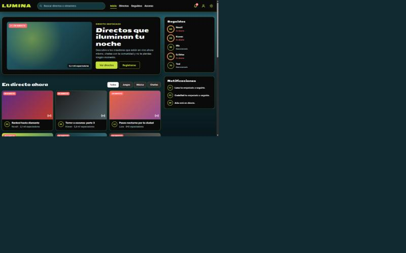
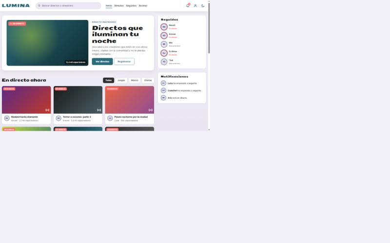
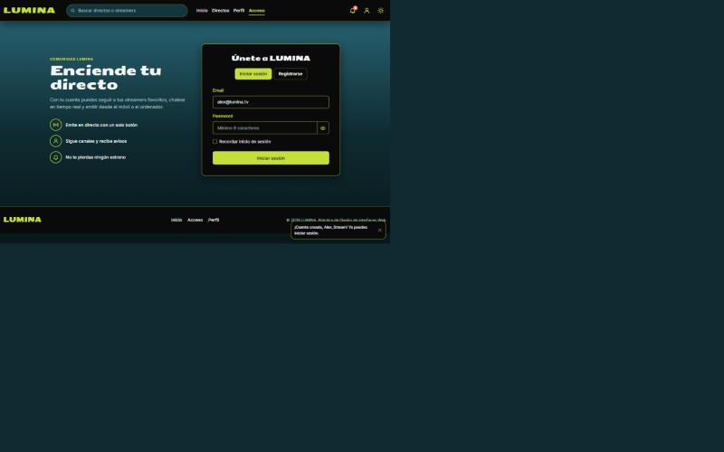
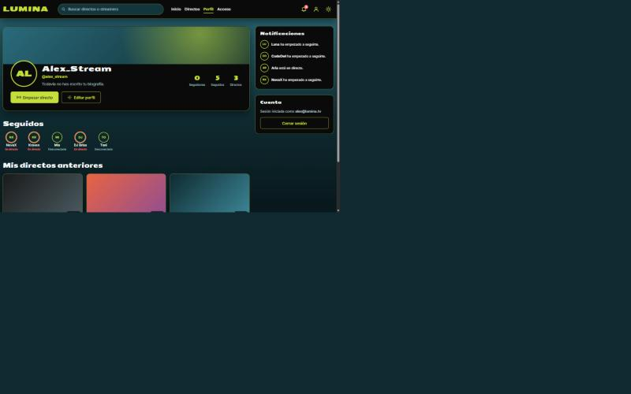
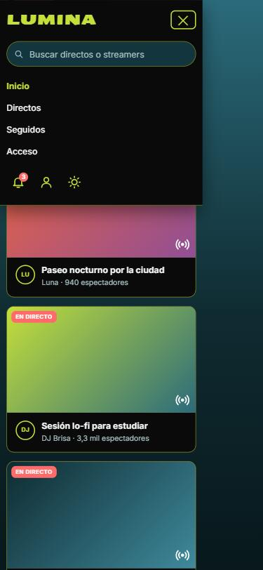
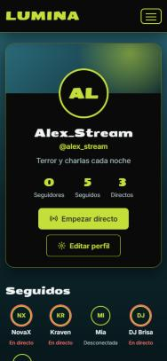

# LUMINA · Plataforma de streaming

Maquetación de la página de inicio de **LUMINA**, una plataforma de directos, a partir del diseño de [Figma](https://www.figma.com/design/KQXxr5PHnq3oVRxze67wgv/LUMINA?node-id=24-5594). El proyecto usa **HTML5 semántico**, **Bootstrap 5.3** (compilado desde sus fuentes Sass locales), **Sass modular** y **JavaScript** sin dependencias.



## Páginas

| Página | Contenido |
|---|---|
| [`index.html`](index.html) · Inicio | Directo destacado, rejilla de directos con filtro por categoría y búsqueda, canales seguidos, llamada al registro y preguntas frecuentes. |
| [`login.html`](login.html) · Acceso | Tarjeta con pestañas **Iniciar sesión / Registrarse** (`login.html#registro` abre directamente el registro). Al iniciar sesión se redirige al perfil. |
| [`perfil.html`](perfil.html) · Perfil | Avatar, nombre, biografía y estadísticas (seguidores, seguidos, directos), botón **Empezar directo**, formulario **Editar perfil**, canales seguidos, directos anteriores y notificaciones. |

Las tres comparten la misma cabecera (con menú hamburguesa, buscador y conmutador de tema), el mismo pie y un único `script.js`.

**Flujo:** registrarse → la pestaña pasa a *Iniciar sesión* con el email ya escrito → iniciar sesión → el perfil muestra el nombre y el email guardados (`localStorage`). *Cerrar sesión* borra esos datos.

## Funcionalidades

| Requisito | Implementación |
|---|---|
| Menú hamburguesa responsive | `navbar-expand-lg` de Bootstrap + `bootstrap.bundle.min.js` (incluye Popper). El icono se anima a una **X** con CSS y el menú se cierra solo al pulsar un enlace. |
| Validación de formularios | Login, registro y edición de perfil con atributos HTML5 (`required`, `type="email"`, `minlength`, `maxlength`, `pattern`) + JS: clase `was-validated`, comprobación de que las contraseñas coinciden (`setCustomValidity`), foco en el primer error y aviso (*toast*) al enviar. |
| Modo claro / oscuro | Botón sol/luna que alterna `data-bs-theme` en `<html>`. Los colores salen de un mapa Sass que genera *custom properties* por tema. La preferencia se guarda en `localStorage` (vale para las tres páginas) y, la primera vez, se respeta `prefers-color-scheme`. |
| Grid de 12 columnas | Columna principal `col-lg-9` + barra lateral `col-lg-3`; tarjetas con `row-cols-1 row-cols-sm-2 row-cols-xl-3`; login en `col-lg-5` + `col-lg-6`. Diseño *mobile-first*. |
| Interactividad del DOM | Filtro de directos y búsqueda (también desde otras páginas con `index.html?q=`), mostrar/ocultar contraseña, edición del perfil que actualiza el nombre, las iniciales del avatar y la biografía, contador de caracteres y botón de directo que cambia de estado. |
| Componentes Bootstrap | Navbar, Nav pills (tabs), Collapse, Accordion, Toast, Forms, Buttons, adaptados con la identidad corporativa. |

## Identidad visual (UI Kit de Figma)

| Token Sass | Color | Uso |
|---|---|---|
| `$lm-graphite` | `#2E2E2E` | Botón "Sin seleccionar", texto sobre lima |
| `$lm-abyss` | `#0F2B31` | Fondo profundo (modo oscuro) |
| `$lm-teal` | `#2B6B7B` | Degradado de fondo, acento del modo claro |
| `$lm-lime` | `#C5DF3A` | Logo, iconos, bordes y botón principal |

- **Seymour One**: logo y titulares (`$lm-font-display`).
- **Inter**: texto de interfaz (`$lm-font-body`).

## Estructura del proyecto

```
lumina/
├── index.html                  ← Página principal
├── login.html                  ← Inicio de sesión y registro
├── perfil.html                 ← Perfil de usuario
├── css/
│   └── style.css              ← CSS compilado (enlazado en el HTML)
├── js/
│   ├── bootstrap.bundle.js     ← Bootstrap + Popper (versión legible)
│   ├── bootstrap.bundle.min.js ← Bootstrap + Popper (minificado, el que se usa)
│   ├── theme-init.js           ← Aplica el tema guardado antes de pintar
│   └── script.js               ← Tema, menú, filtros, login/registro y perfil (por módulos)
├── scss/
│   ├── style.scss              ← Punto de entrada: importa todo en orden
│   ├── abstracts/
│   │   ├── _variables.scss     ← Paleta, tipografías, mapa de temas y overrides de Bootstrap
│   │   └── _mixins.scss        ← respond-to, focus-ring, smooth, lift, theme, circle
│   ├── base/
│   │   ├── _themes.scss        ← Genera las variables CSS de modo claro/oscuro
│   │   └── _base.scss          ← Estilos globales, skip-link, cabeceras de sección
│   ├── layout/
│   │   ├── _header.scss        ← Cabecera, navbar, hamburguesa y buscador
│   │   └── _footer.scss
│   ├── components/
│   │   ├── _botones.scss       ← .btn-lumina, .icon-btn, chips y conmutador de tema
│   │   ├── _cards.scss         ← .hero, .stream-card, .live-badge, .avatar
│   │   ├── _formularios.scss   ← .auth-card, .auth-form, toast
│   │   ├── _sidebar.scss       ← Seguidos y notificaciones
│   │   └── _accordion.scss     ← Override del acordeón de Bootstrap
│   ├── pages/
│   │   ├── _login.scss         ← Presentación de la página de acceso
│   │   └── _perfil.scss        ← Cabecera del perfil, estadísticas y edición
│   └── vendor/bootstrap/       ← Fuentes Sass de Bootstrap 5.3.8 (sin modificar)
├── docs/capturas/              ← Capturas para este README
└── package.json                ← Scripts de compilación con Dart Sass
```

### Metodología

- **BEM** para las clases propias: `.stream-card__thumb--lima`, `.site-header__brand`, `.follow-list__item--live`…
- **Sin `!important`** en el código propio. Además, `$enable-important-utilities: false` quita el `!important` de las utilidades de Bootstrap (solo quedan las pocas reglas internas del propio framework).
- **Microinteracciones** accesibles: `:hover` (elevación de tarjetas, subrayado animado del menú) y `:focus-visible` (anillo de foco de alto contraste con el mixin `focus-ring`). Se respeta `prefers-reduced-motion`.
- **Accesibilidad**: enlace "Saltar al contenido", `aria-label`/`aria-pressed`/`aria-expanded`, `role="search"`, mensajes de error asociados a cada campo.

## Cómo compilar el Sass

Bootstrap ya está dentro de `scss/vendor/bootstrap`, así que **no hace falta instalar nada para compilar con Live Sass Compiler**.

### Opción A · Live Sass Compiler (VS Code)

1. Instala la extensión **Live Sass Compiler** (Glenn Marks).
2. Abre la carpeta `lumina/` en VS Code. El archivo `.vscode/settings.json` ya configura la salida en `/css` y excluye `scss/vendor`.
3. Pulsa **Watch Sass** en la barra de estado: `scss/style.scss` se compila a `css/style.css`.

### Opción B · Terminal (Dart Sass)

```bash
npm install
```

```bash
npm run build
```

Otros scripts: `npm run watch` (recompila al guardar) y `npm run build:min` (genera `css/style.min.css`).

## Validación W3C

| Validador | Resultado |
|---|---|
| [Nu HTML Checker](https://validator.w3.org/nu/) (`index.html`, `login.html`, `perfil.html`) | **0 errores, 0 avisos** en las tres páginas |
| [CSS Validator](https://jigsaw.w3.org/css-validator/) (`css/style.css`, perfil CSS3 + SVG) | **0 errores**. Los avisos son extensiones de navegador (`-webkit-`, `-moz-`) y variables CSS que genera Bootstrap, no errores. |

<!-- Sustituye estas rutas por tus propias capturas del validador -->


## Capturas

| Inicio · modo claro | Acceso | Perfil |
|---|---|---|
|  |  |  |

| Móvil · menú desplegado | Móvil · perfil |
|---|---|
|  |  |

## Tecnologías

HTML5 · Sass (Dart Sass 1.93) · Bootstrap 5.3.8 · JavaScript (ES6) · Google Fonts (Inter, Seymour One)
